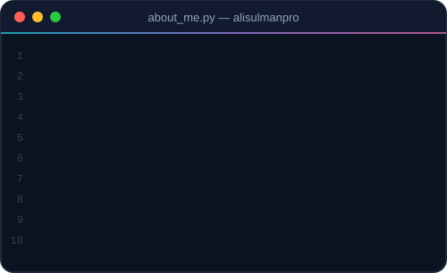

<!-- Profile README of Ali Sulman (alisulmanpro) — Full-Stack AI Developer -->

  

<h1 align="center">Hi 👋, I'm Ali Sulman</h1>
<h3 align="center">Full-Stack AI Developer from Pakistan — I build AI-powered web apps with Next.js, FastAPI &amp; Python ML</h3>

  

  
  
  
  

  
  
  

## 🧠 About Me

I'm **Ali Sulman** (`alisulmanpro`), a **full-stack AI developer** who turns ideas into production-ready products — from data pipelines and ML models to fast, modern web apps.

- 🏢 **Junior Software Engineer** at **Pakistan Artificial Intelligence Lab**
- 🤖 Building ML systems and deploying them as real-time **FastAPI** services
- ⚡ Crafting frontends with **Next.js**, **TypeScript** and **Tailwind CSS**
- 🌱 Currently learning **Deep Learning**, **advanced NLP** and **MLOps**
- 🤝 Open to collaborate on **open-source ML, NLP and backend** projects
- 💬 Ask me about **Python, FastAPI, Django, Next.js, scikit-learn**

 

## 💼 Experience

| 🏢 Company | 🧑‍💻 Role | 📍 Location | 📅 Duration |
|:--|:--|:--|:--|
| **Pakistan Artificial Intelligence Lab** | Junior Software Engineer | Narowal, Pakistan | Jul 2025 – Present |
| **Systems Private Limited** | DPE — Document Processing | Lahore, Pakistan | Oct 2024 – Jun 2025 |

<b>What I do at Pakistan Artificial Intelligence Lab</b>

 

- Python & machine learning projects: data processing, model building and practical AI applications
- Web development instructor and lab assistant in seminars
- Stack: `Python` `pandas` `NumPy` `seaborn` `scikit-learn` `Django`

## 📌 Featured Gists

  
  
  
  

## 🛠️ Tech Stack

<table align="center">
  <tr>
    <td align="center" width="170"><b>🤖 AI / ML</b></td>
    <td></td>
  </tr>
  <tr>
    <td align="center"><b>📊 Data</b></td>
    <td>
      
      
      
      
      
    </td>
  </tr>
  <tr>
    <td align="center"><b>⚙️ Backend</b></td>
    <td></td>
  </tr>
  <tr>
    <td align="center"><b>🎨 Frontend</b></td>
    <td></td>
  </tr>
  <tr>
    <td align="center"><b>☁️ DevOps &amp; Tools</b></td>
    <td></td>
  </tr>
</table>

## 📈 GitHub Analytics

  
  

  

  <b>⭐ Let's build something with AI together — <a href="mailto:alisulmanpro1470@gmail.com">get in touch</a>!</b>

  

